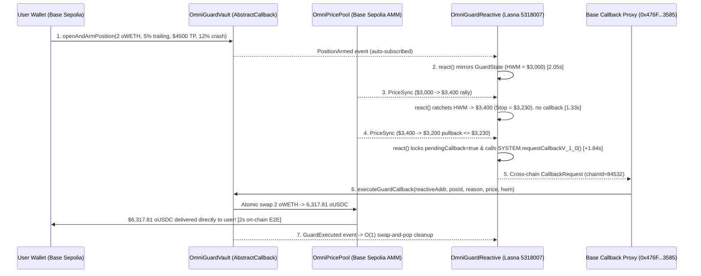

# OmniGuard — Keeper-less Sub-Second Trailing Stop-Loss, Take-Profit & Flash-Crash Shield

> Built for the **Reactive Omni Buildathon** (**Track 1: Every Second Counts** — Base Sepolia × Reactive Lasna Omni)
>
> **Verified On-Chain End-to-End Cross-Chain Latency: `2 seconds` (`7 Base Sepolia blocks`, `3.38s` wall-clock)**

**OmniGuard** is an autonomous, keeper-less DeFi position protection protocol powered by **Reactive Omni** (`reactive-lib-omni`, `SYSTEM = 0x8888...8888`, `requestCallbackV_1_0`) and **Base Sepolia (200ms Flashblocks)**.

Instead of relying on centralized off-chain keeper bots that lag, drop RPC connections, or censor users during volatility spikes, **OmniGuard** runs a stateful on-chain guardian directly on **Reactive Lasna** (~1s CometBFT finality):
- **Zero-Friction UX**: Users interact **100% on Base Sepolia** — they never need `lREACT` or transactions on Reactive Lasna.
- **Auto-Mirrored State Machine**: `OmniGuardReactive` subscribes to `PositionArmed`, `PositionDisarmed`, and `GuardExecuted` events from `OmniGuardVault` on Base Sepolia, maintaining an O(1) swap-and-pop active position registry.
- **Stateful High-Water Mark (HWM) Ratchet**: On every `PriceSync` event from `OmniPricePool`, `react()` updates rolling EWMA price state and ratchets each position's `highWaterMark` upward during rallies without firing premature callbacks.
- **Multi-Condition Risk Engine**: Evaluates **Flash-Crash Circuit Breaker** (single-tick drawdown threshold) → **Trailing Stop-Loss** (`spotPrice <= HWM × (10000 - trailingBps) / 10000`) → **Hard Take-Profit** in strict risk-priority order.
- **Anti-Duplicate Callback Lock & Graceful Stale Handling**: Sets `pendingCallback = true` while a `V_1_0` callback is in flight to prevent double-execution across rapid 200ms Base Sepolia blocks; destination callbacks emit `GuardSkipped` instead of reverting if manually disarmed, avoiding wasted `CallbackFailure` fees.
- **Atomic On-Chain Settlement**: Base Sepolia's official Omni Callback Proxy (`0x476F44b11F5C942c58f4c8E3d0300E5710743585`) calls `OmniGuardVault.executeGuardCallback(...)`, verified via dual authentication (`onlyServiceProvider` + `onlyCallbackSender`), atomically swapping protected `oWETH` collateral into `oUSDC` and delivering proceeds directly to the user's wallet.

---

## Architecture



---

## Deployed Contracts (Live on Base Sepolia & Reactive Lasna)

| Component | Network | Chain ID | Address |
| --- | --- | --- | --- |
| **OmniGuardReactive** | Reactive Lasna | `5318007` | [`0x45F12F7114265C090E52f2fd5E8e61f6Dec035b0`](https://lasna.reactscan.net/address/0x45F12F7114265C090E52f2fd5E8e61f6Dec035b0) |
| **OmniGuardVault** | Base Sepolia | `84532` | [`0x0D8D503eA193Ceb3c98264e20463Aa608aD78671`](https://sepolia.basescan.org/address/0x0D8D503eA193Ceb3c98264e20463Aa608aD78671) |
| **OmniPricePool** | Base Sepolia | `84532` | [`0x89d861fB6D69adC5BF3D6523e673F81b5749DCD2`](https://sepolia.basescan.org/address/0x89d861fB6D69adC5BF3D6523e673F81b5749DCD2) |
| **oWETH (Testnet Token)** | Base Sepolia | `84532` | [`0x45F12F7114265C090E52f2fd5E8e61f6Dec035b0`](https://sepolia.basescan.org/address/0x45F12F7114265C090E52f2fd5E8e61f6Dec035b0) |
| **oUSDC (Testnet Token)** | Base Sepolia | `84532` | [`0x55798e19AE5027F5eCf4cfD5C1E7452c93184BfB`](https://sepolia.basescan.org/address/0x55798e19AE5027F5eCf4cfD5C1E7452c93184BfB) |
| **Lasna System Contract (Omni)** | Reactive Lasna | `5318007` | [`0x8888888888888888888888888888888888888888`](https://lasna.reactscan.net/address/0x8888888888888888888888888888888888888888) |
| **Base Callback Proxy (Omni)** | Base Sepolia | `84532` | [`0x476F44b11F5C942c58f4c8E3d0300E5710743585`](https://sepolia.basescan.org/address/0x476F44b11F5C942c58f4c8E3d0300E5710743585) |

---

## Verified Live Cross-Chain Execution Proof

Every stage below executed autonomously on **Base Sepolia** and **Reactive Lasna** with **zero off-chain keepers** (recorded verbatim in [`live-proof.json`](./live-proof.json)):

| Stage | Origin Tx (Base Sepolia) | Reactive Tx (Lasna `5318007`) | Callback Tx (Base Sepolia) | Result & Measured Latency |
| --- | --- | --- | --- | --- |
| **1. Arm Position #1** (`2 oWETH`, `$3,000` entry, `5%` trailing stop) | [`0xe878b9...048fea`](https://sepolia.basescan.org/tx/0xe878b9a3d26d9fc079ae514900e6bed3a0f285443788622939e29f67fa048fea) | [`0xfc21d1...ff3ba6d`](https://lasna.reactscan.net/tx/0xfc21d1c17067bddda19dd08886b0d598e9e8540c2b43b4b333a6c02f0ff3ba6d) | *(Auto-mirror state)* | Lasna auto-registered Position #1 in **`2.05s`** |
| **2. Rally +13.3%** (`$3,000 → $3,400`) | [`0x8ebd70...cbf2e1`](https://sepolia.basescan.org/tx/0x8ebd70dc35e69537db35411b5fb56a752b9b5e71c84a1d7e8cc803eab3cbf2e1) | [`0x5317ae...9361b936e`](https://lasna.reactscan.net/tx/0x5317aeb2dd253a522ca22b72259b06483c2c1df6af8baf513ad431a9361b936e) | *(No callback — hold)* | HWM ratcheted `$3,000 → $3,400`, trailing stop raised to **`$3,230`** in **`1.33s`** |
| **3. Pullback Breach** (`$3,400 → $3,200 <= $3,230`) | [`0x1e1e7f...8ec91fd7`](https://sepolia.basescan.org/tx/0x1e1e7f68cd2297eb4f1f282071e939de3dd06af9ce8850c6a3e7e95a8ec91fd7) (block `63510485`) | [`0x70cacb...e6a988b`](https://lasna.reactscan.net/tx/0x70cacb1e64210ae8e452800644535d19b05152bcbbc91541190c61bd4e6a988b) (`+1.84s`) | [`0xa17f9c...4a4022d`](https://sepolia.basescan.org/tx/0xa17f9c16683d872a3cfcae90c23d99e664f8f72ca7c2ab25d69a2a6944a4022d) (block `63510492`) | **`$6,317.81 oUSDC`** delivered (+`$317.81` locked profit) in **`2s` on-chain (`7 Base blocks`, `3.38s` wall-clock)** |

---

## Quick Start & Reproducibility

### 1. Run Automated Unit & Security Tests (Solidity `0.8.29`)
```bash
npm install
npm test
```

All **7 test suites** verify:
- Official `AbstractReactive` (`SYSTEM = 0x8888...8888` via `hardhat_setCode`) registering all 4 subscriptions.
- Full Trailing Stop-Loss lifecycle: rally HWM ratchet → mild dip hold → trailing stop breach → anti-duplicate lock → callback swap → O(1) cleanup.
- Flash-Crash Circuit Breaker priority override.
- Hard Take-Profit execution.
- Graceful `GuardSkipped` handling on stale callbacks after manual disarm.
- Strict Omni authorization (`onlySystem`, `onlyServiceProvider`, `onlyCallbackSender`).
- `coverDebt()` settlement on both Lasna and Base Sepolia.

### 2. Re-Deploy & Run Live Cross-Chain Proof
```bash
cp .env.example .env
# Fund DEPLOYER_PRIVATE_KEY with testnet ETH, then convert to lREACT & bridge:
node scripts/bridge-and-fund.js   # or `npm run fund:lasna` if already on Base Sepolia
npm run deploy:live
npm run demo:live
```

### 3. Launch the Live Interactive Dashboard
```bash
cd frontend
npm install
npm run dev
```

---

## Security & Reactive Omni Best Practices

- Built on official **`reactive-lib-omni`** (`AbstractReactive`, `AbstractCallback`, `ISystemContract.requestCallbackV_1_0`) — zero deprecated `emit Callback(...)`.
- Enforces **dual callback authentication** (`onlyServiceProvider` + `onlyCallbackSender(reactive_)`) with `address(0)` first-argument placeholder overwritten by Reactive Network.
- Bounds per-tick loop (`MAX_POSITIONS_SCAN = 25`) to stay safely within Reactive Lasna's 900,000 gas cap.
- Sets `CALLBACK_GAS_LIMIT = 500_000` (well above the 100,000 minimum and proxy `_extraGas + _maxChargeGas` overhead).
- Pre-funds both `SYSTEM.depositTo(reactive)` and `CALLBACK_PROXY.depositTo(vault)` reserves and exposes `coverDebt()` on both contracts.
